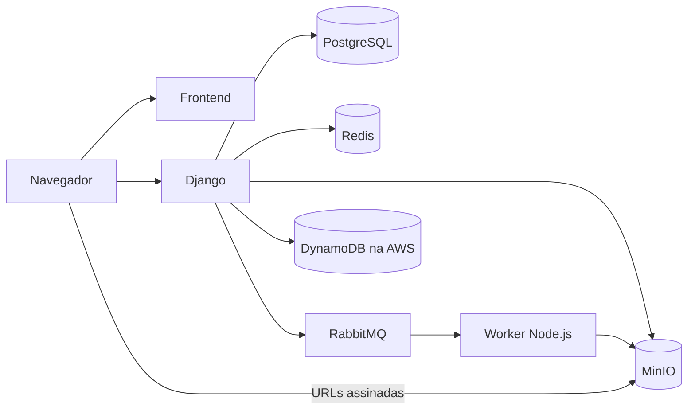

# Brechó Online com Docker

React + Django + worker Node.js executados pelo Docker Compose. O PostgreSQL, o MinIO, o RabbitMQ e o Redis rodam em contêineres locais. **O DynamoDB continua na AWS** para os registros de auditoria.

| Componente anterior | Execução atual |
| --- | --- |
| Backend e frontend na EC2 | Imagens próprias criadas com Dockerfile |
| PostgreSQL no Amazon RDS | Imagem oficial PostgreSQL 17, administrada localmente |
| Arquivos no Amazon S3 | MinIO com bucket privado e URLs assinadas |
| SNS/SQS | RabbitMQ com mensagens persistentes e confirmação de entrega |
| Cache remoto | Redis local |
| DynamoDB | Mantido na AWS |



## Iniciar

Pré-requisitos: Docker Engine e Docker Compose v2, acesso à internet para baixar as imagens/dependências e credenciais AWS válidas para a tabela DynamoDB existente. Não é necessário instalar Python, Node.js ou PostgreSQL no host.

1. Na raiz do projeto, copie a configuração:

   ```bash
   cp .env.example .env
   ```

2. Edite o `.env` da raiz. Preencha `AWS_REGION`, `DYNAMODB_TABLE`, `AWS_ACCESS_KEY_ID`, `AWS_SECRET_ACCESS_KEY` e, para credenciais temporárias do Academy, `AWS_SESSION_TOKEN`. A tabela deve ter chave de partição `id` do tipo String; as credenciais devem permitir `dynamodb:PutItem` nessa tabela. A aplicação mantém a implementação de auditoria existente e não cria nem substitui a tabela. As credenciais do MinIO são locais e independentes das credenciais AWS.

3. Construa e inicie:

   ```bash
   docker compose up -d --build
   docker compose ps
   docker compose logs -f backend worker
   ```

O Compose espera os serviços ficarem saudáveis, cria o bucket privado do MinIO e executa as migrations antes de iniciar o Django. O frontend roda pelo servidor de desenvolvimento do Vite, e o backend roda com o `runserver` do Django. Como não há proxy reverso, o frontend acessa a API diretamente em `http://localhost:8000/api/`.

O serviço MinIO usa a distribuição comunitária `coollabsio/minio`, mantida pelo projeto Coolify, com versão e digest fixados no Compose. Essa imagem também inclui o cliente `mc`, usado para inicializar o bucket e verificar a saúde do serviço. Os repositórios anteriores `minio/minio` e `minio/mc` não estavam disponíveis durante a validação.

| Acesso | Endereço | Credenciais locais padrão |
| --- | --- | --- |
| Aplicação | http://localhost:5173 | Cadastro pela interface |
| Admin Django | http://localhost:8000/admin/ | Criar superusuário |
| Documentação da API | http://localhost:8000/api/docs/ | — |
| API direta | http://localhost:8000/api/ | — |
| Console MinIO | http://localhost:9001 | `minioadmin` / `minioadmin` |
| API MinIO e imagens assinadas | http://localhost:9000 | Bucket privado |
| Painel RabbitMQ | http://localhost:15672 | `brecho` / `brecho` |

As portas publicadas são restritas ao host local. PostgreSQL, Redis e AMQP ficam acessíveis apenas pela rede do Compose. Os valores padrão são para desenvolvimento; configure senhas próprias no `.env`. Use credenciais RabbitMQ alfanuméricas, pois são interpoladas na URL AMQP. Ao alterar credenciais do PostgreSQL/RabbitMQ com volumes existentes, atualize também os usuários dentro dos serviços.

O Compose usa **somente o `.env` da raiz**: os `.env` antigos do backend, frontend e worker são excluídos das imagens. `MINIO_PUBLIC_ENDPOINT_URL` deve ser o endereço que o navegador alcança; dentro dos contêineres, o endereço usado para operações é `http://minio:9000`. O frontend usa `VITE_API_URL=http://localhost:8000/api` para acessar o backend diretamente.

## Rotas

### Frontend

| Rota | Descrição |
| --- | --- |
| `/` | Lista de produtos |
| `/cadastro` | Cadastro de usuário |
| `/login` | Login |
| `/produto/:id` | Detalhes de um produto |
| `/anunciar` | Criar anúncio |
| `/anunciar/:id` | Editar anúncio |
| `/meus-anuncios` | Anúncios do usuário |

### Backend/API

Todas as rotas abaixo usam a base `http://localhost:8000`:

| Rota | Descrição |
| --- | --- |
| `/health/` | Healthcheck |
| `/admin/` | Administração do Django |
| `/api/products/` | Produtos |
| `/api/categories/` | Categorias |
| `/api/users/` | Usuários |
| `/api/token/` | Obter token JWT |
| `/api/token/refresh/` | Renovar token JWT |
| `/api/schema/` | Schema OpenAPI |
| `/api/docs/` | Swagger da API |

## Preparar dados e testar

Crie um administrador:

```bash
docker compose exec backend python manage.py createsuperuser
```

Cadastre pelo menos uma categoria no admin antes de anunciar. Depois:

1. Cadastre um usuário e faça login na aplicação.
2. Crie um anúncio com imagem JPEG ou PNG.
3. Acompanhe `docker compose logs -f worker`: ele deve gravar `thumb_300.jpg` e `thumb_600.jpg` no MinIO. A miniatura de 600px recebe a marca d'água.
4. Consulte o produto e abra sua imagem. As URLs assinadas expiram em uma hora; uma nova consulta ao backend gera novas URLs quando o cache é renovado.
5. Confira no console MinIO o original e as duas miniaturas em `brecho-products/produtos/{image_id}/`.
6. Confira na tabela DynamoDB os eventos de leitura/criação/alteração/exclusão. Sem credenciais válidas a auditoria registra erros nos logs, conforme o comportamento existente da aplicação.

O campo `s3_key` foi preservado no banco e no contrato das mensagens; ele representa agora a chave do objeto no MinIO. Isso permite reaproveitar os dados e as migrations existentes. O worker sempre gera miniaturas JPEG, inclusive para originais PNG. O processamento é assíncrono: a miniatura pode levar alguns segundos para aparecer após o upload.

```bash
# Verificar API
curl -f http://localhost:8000/health/
curl -f http://localhost:8000/api/products/

# Verificar Django e executar os testes das integrações adaptadas
docker compose exec backend python manage.py check
docker compose exec backend python manage.py test products

# Ver mensagens prontas, em processamento e fila de falhas
docker compose exec rabbitmq rabbitmqctl list_queues name messages_ready messages_unacknowledged
```

A fila `image-processing` é durável. O backend publica mensagens persistentes e aguarda confirmação do RabbitMQ. O worker processa uma mensagem por vez e só confirma após gravar as duas miniaturas. Se o worker cair antes da confirmação, a mensagem é entregue novamente. Se o processamento falhar, a mensagem vai para `image-processing.failed`; consulte o erro nos logs e use o painel RabbitMQ para obter a mensagem e republicá-la na fila principal após corrigir a causa. A gravação das miniaturas usa as mesmas chaves, permitindo reprocessamento.


## Operação

```bash
# Parar sem perder banco, arquivos, cache ou filas
docker compose down

# Iniciar novamente
docker compose up -d

# Reconstruir após mudanças de código
docker compose up -d --build

# Renovar credenciais AWS temporárias após editar o .env
docker compose up -d --force-recreate backend
```


Os volumes `postgres_data`, `minio_data`, `rabbitmq_data` e `redis_data` preservam os dados entre reinicializações. `docker compose down -v` remove esses dados permanentemente.

| Problema | Verificação |
| --- | --- |
| DynamoDB `ExpiredToken` / `AccessDenied` | Renove credenciais no `.env`, recrie o backend e confira região, tabela e permissões |
| Imagem não carrega | Confira `MINIO_PUBLIC_ENDPOINT_URL`, os logs do worker e a existência de `thumb_600.jpg` no bucket |
| Mensagem em `.failed` | Corrija a causa no worker/MinIO e republique pelo painel RabbitMQ |
| Backend não inicia | Consulte `docker compose logs backend postgres` e os healthchecks |
| Porta ocupada | Pare o processo conflitante ou ajuste o mapeamento e as origens/URLs no `.env` |
