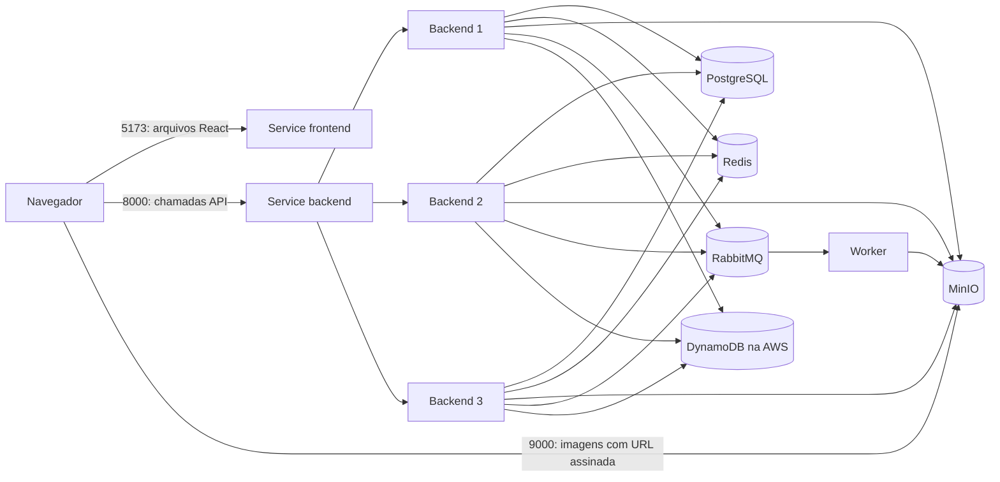

# Brechó Online no Kubernetes

Guia para executar o projeto localmente com Minikube e Docker. Todos os comandos abaixo
partem da **raiz do repositório**, não desta pasta. O namespace usado é `default`
e o perfil Minikube é `minikube`.

## Serviços

| Componente | Recurso | Réplicas | Persistência |
| --- | --- | --- | --- |
| Backend Django | Deployment + Service `backend` | 3 | PostgreSQL compartilhado |
| Frontend React/Vite | Deployment + Service `frontend` | 1 | Sem volume |
| Worker de imagens | Deployment | 1 | Consome RabbitMQ e grava no MinIO |
| PostgreSQL | StatefulSet + Service `postgres-service` | 1 | PVC de 5 GiB |
| MinIO | StatefulSet + Service headless `minio` | 1 | PVC de 5 GiB |
| RabbitMQ | StatefulSet + Service headless `rabbitmq` | 1 | PVC de 1 GiB |
| Redis | StatefulSet + Service headless `redis-service` | 1 | PVC de 1 GiB, AOF |
| Criação do bucket privado | Job `minio-init` | Uma execução | Bucket no MinIO |
| Auditoria | DynamoDB na AWS | Externo | Tabela já existente |

O [Kustomize principal](./kustomization.yaml) cria os Secrets a partir de `.env`
e atualiza as referências dos Pods. Não é necessário instalar o Kustomize
separadamente: ele já está integrado ao `kubectl`.



## 1. Pré-requisitos e cluster

Instale [Docker Engine](https://docs.docker.com/engine/install/),
[kubectl](https://kubernetes.io/docs/tasks/tools/) e
[Minikube](https://minikube.sigs.k8s.io/docs/start/). O Docker deve funcionar
para seu usuário. Não é necessário ativar o ambiente virtual Python do host.

Reserve recursos para esta aplicação; 4 CPUs e 6 GiB de RAM são um ponto de
partida, ajustável à sua máquina. As imagens precisam de acesso à internet no
primeiro build/download e os PVCs solicitam 12 GiB no total.

```bash
docker info
kubectl version --client
minikube version
minikube start -p minikube --driver=docker --cpus=4 --memory=6144
kubectl config use-context minikube
kubectl config set-context --current --namespace=default
kubectl get nodes
kubectl get storageclass
```

Espere o nó ficar `Ready`. O Minikube normalmente fornece uma StorageClass padrão
para os PVCs. Se ela estiver ausente:

```bash
minikube addons enable storage-provisioner -p minikube
minikube addons enable default-storageclass -p minikube
kubectl get storageclass
```

## 2. Variáveis de ambiente

Na primeira preparação, copie [env.example](./env.example). Se `.env` já existe,
compare as chaves e preserve seus valores; não sobrescreva as credenciais usadas
por volumes existentes.

```bash
cp -n k8s/env.example k8s/.env
```

Edite `k8s/.env`. Ele está ignorado pelo Git. O arquivo de exemplo não contém
credenciais AWS reais. A configuração Kubernetes usa esse arquivo, não o `.env`
da raiz usado pelo Compose.

| Variável | Quem usa e para quê |
| --- | --- |
| `POSTGRES_*` | Inicialização do banco e credenciais do backend |
| `MINIO_ENDPOINT_URL=http://minio:9000` | Backend/worker acessam o Service interno |
| `MINIO_PUBLIC_ENDPOINT_URL=http://localhost:9000` | Backend gera links de imagens para o navegador |
| `VITE_API_URL=http://localhost:8000/api` | React, executando no navegador, chama a API |
| `MINIO_ROOT_*` | Servidor MinIO; mapeadas para as credenciais dos clientes |
| `RABBITMQ_USER`, `RABBITMQ_PASSWORD` | Servidor e montagem da URL AMQP nos Pods |
| `RABBITMQ_IMAGE_QUEUE` | Mesmo nome de fila no backend e worker |
| `DYNAMODB_TABLE`, `AWS_*` | Auditoria na AWS |

Mantenha `MINIO_REGION=us-east-1` enquanto o servidor em [minIO.yaml](./minIO.yaml)
usar essa região. O frontend usa o servidor Vite de desenvolvimento, que recebe
`VITE_API_URL` ao iniciar.

Para registrar a auditoria, a tabela DynamoDB deve existir na região configurada,
ter chave de partição `id` do tipo String e permitir `dynamodb:PutItem` às
credenciais fornecidas. Credenciais temporárias exigem também `AWS_SESSION_TOKEN`.
Os manifestos não criam essa tabela. Sem credenciais válidas, os eventos de auditoria
não são gravados e erros aparecem nos logs da aplicação.

## 3. Construir e carregar as imagens corretas

Cada tag deve usar o Dockerfile e o contexto correspondentes:

```bash
docker build -t brecho-backend:v1 -f Backend/Dockerfile Backend
docker build -t brecho-frontend:v1 -f Frontend/Dockerfile Frontend
docker build -t brecho-worker:v1 -f Worker/Dockerfile Worker

docker image inspect brecho-backend:v1 brecho-frontend:v1 brecho-worker:v1 \
  --format '{{.RepoTags}} {{.Id}} {{json .Config.Entrypoint}} {{json .Config.Cmd}}'

minikube image load brecho-backend:v1 --overwrite=true -p minikube
minikube image load brecho-frontend:v1 --overwrite=true -p minikube
minikube image load brecho-worker:v1 --overwrite=true -p minikube
```

O backend deve executar `/app/entrypoint.sh` e Django; o worker executa
`node src/index.js`. As tags deles não devem apontar para a mesma imagem.
Os manifestos usam `IfNotPresent`: ter a imagem somente no Docker do host não
garante que ela esteja disponível no runtime do Minikube.

## 4. Subir a infraestrutura primeiro

Para um banco novo, use a [configuração de bootstrap](../k8s-bootstrap/kustomization.yaml).
Ela mantém os mesmos recursos e Secrets, mas inicia backend, frontend e worker
com zero réplicas. Isso permite esperar os serviços antes de iniciar a aplicação.
**Use esta etapa na preparação inicial: reaplicá-la com a aplicação em execução
desliga temporariamente os três Deployments.**

```bash
kubectl kustomize k8s-bootstrap/ > /dev/null
kubectl apply -k k8s-bootstrap/
kubectl rollout status statefulset/postgres --timeout=300s
kubectl rollout status statefulset/redis --timeout=300s
kubectl rollout status statefulset/rabbitmq --timeout=300s
kubectl rollout status statefulset/minio --timeout=300s
kubectl wait --for=condition=complete job/minio-init --timeout=300s
kubectl get pvc
```

Os PVCs devem estar `Bound` e o Job deve concluir. `minio-init` em `Completed`
com `0/1` é normal: ele termina depois de criar o bucket e configurar acesso privado.
Se o primeiro download demorar e o Job exceder seu prazo de 180 segundos, espere
o MinIO ficar pronto, exclua apenas o Job e reaplique o bootstrap.

## 5. Preparar o banco e iniciar três réplicas

O [entrypoint do backend](../Backend/entrypoint.sh) executa migrations antes de
iniciar o servidor. Comece com **uma réplica** para evitar três processos
alterando simultaneamente o esquema de um banco novo:

```bash
kubectl scale deployment/backend --replicas=1
kubectl rollout status deployment/backend --timeout=300s
kubectl logs deployment/backend --tail=60
```

Só prossiga quando o backend estiver pronto e as migrations concluídas. Depois
aplique o estado final declarado em [backend.yaml](./backend.yaml):

```bash
kubectl apply -k k8s/
kubectl rollout status deployment/backend --timeout=300s
kubectl rollout status deployment/frontend --timeout=300s
kubectl rollout status deployment/worker --timeout=300s
kubectl get deployments,statefulsets,pods,services,pvc
```

Resultado esperado: backend `3/3`, frontend e worker `1/1`, quatro StatefulSets
com `1/1` e o Job concluído. O worker declara as filas automaticamente ao conectar.

Essa sequência usa a imagem que já executava migrations na inicialização. Para
futuras alterações de esquema, prefira um Job exclusivo de migrations antes de
atualizar as réplicas; esse Job ainda não faz parte dos manifestos atuais.

## 6. Acessar pelo navegador

Execute cada comando em um terminal separado e mantenha-o aberto:

```bash
kubectl port-forward service/frontend 5173:5173
```

```bash
kubectl port-forward service/backend 8000:8000
```

```bash
kubectl port-forward service/minio 9000:9000 9001:9001
```

Opcional, para acessar o painel do RabbitMQ:

```bash
kubectl port-forward service/rabbitmq 15672:15672
```

| Acesso | URL |
| --- | --- |
| Aplicação | http://localhost:5173 |
| Saúde da API | http://localhost:8000/health/ |
| API de produtos | http://localhost:8000/api/products/ |
| Admin Django | http://localhost:8000/admin/ |
| API MinIO / URLs de imagens | http://localhost:9000 |
| Console MinIO | http://localhost:9001 |
| Painel RabbitMQ | http://localhost:15672 |

Use as credenciais de `k8s/.env` nos painéis MinIO e RabbitMQ. O React executa no
navegador, por isso encaminhar apenas a porta 5173 não permite chamadas à API
nem download das imagens. Não use `http://backend:8000` como URL do navegador.
Evite manter o Compose ocupando as mesmas portas. Se acessar por IP ou domínio,
ajuste também URLs públicas, `ALLOWED_HOSTS`, CORS e CSRF.

## 7. Criar os dados iniciais

Crie um administrador e ao menos uma categoria:

```bash
kubectl exec -it deployment/backend -- python manage.py createsuperuser
kubectl exec deployment/backend -- python manage.py shell -c \
  "from products.models import Category; Category.objects.get_or_create(name='Roupas')"
```

Na interface, cadastre um usuário, faça login e anuncie um produto com imagem.
Confira o original e as miniaturas no bucket `brecho-products` (ou no nome que
você configurou). O frontend usa a miniatura de 600 px, criada pelo worker;
ela pode levar alguns segundos para aparecer.

```bash
kubectl logs deployment/worker --tail=50
kubectl exec rabbitmq-0 -- rabbitmqctl list_queues -p / \
  name consumers messages_ready messages_unacknowledged
```

Espere um consumidor em `image-processing` e nenhum em `image-processing.failed`.
Uma fila vazia depois do processamento é normal. Mensagens na fila `.failed`
indicam falha de processamento e não são tentadas novamente automaticamente.

## 8. Atualizar e reaplicar

Para alterações sem novas migrations, reconstrua a imagem correspondente,
carregue-a no Minikube e reinicie seu Deployment. Exemplo do backend:

```bash
docker build -t brecho-backend:v1 -f Backend/Dockerfile Backend
minikube image load brecho-backend:v1 --overwrite=true -p minikube
kubectl rollout restart deployment/backend
kubectl rollout status deployment/backend --timeout=300s
```

Ao editar `k8s/.env`, os quatro Secrets mudam de nome e os Pods que os referenciam
são atualizados. Como o template do Job existente não pode ser alterado dessa
forma, recrie somente o inicializador e reaplique:

```bash
kubectl delete job minio-init --ignore-not-found
kubectl apply -k k8s/
kubectl wait --for=condition=complete job/minio-init --timeout=300s
kubectl rollout status deployment/backend --timeout=300s
kubectl rollout status deployment/frontend --timeout=300s
kubectl rollout status deployment/worker --timeout=300s
```

O Job pode ser repetido: não recria um bucket já existente e mantém o acesso
anônimo desabilitado. Secrets antigos com sufixos diferentes não são removidos
automaticamente pelo `apply`.

## 9. Parar e retomar

Feche os port-forwards com Ctrl+C e preserve o cluster:

```bash
minikube stop -p minikube
```

Para retomar:

```bash
minikube start -p minikube
kubectl config use-context minikube
kubectl get pods
```

Espere os Pods ficarem prontos e reabra os port-forwards. Não precisa executar
bootstrap em toda retomada. `minikube delete` remove o cluster e pode perder os
dados locais. `kubectl delete -k k8s/` também inclui o PVC explícito do MinIO;
não use esses comandos como forma de parar temporariamente o projeto.
